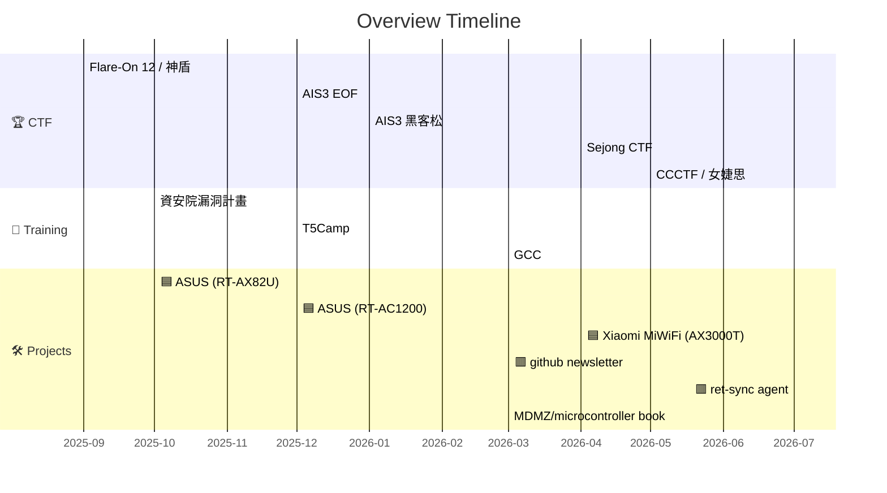

## 0x00 Overview

#### 課程與培訓
- GCC 2026 Vietnam
- TeamT5 培訓
- 好厲駭高階培訓+導師培訓
#### 資安活動
- 資安院漏洞計畫
- Hitcon Girls 讀書會(主題: 漏洞研究與逆向技巧分享)
- 比賽
	- AIS3 黑客松@銀質獎
	- 2025神盾盃CTF@第13名
	- 資安女婕思 CTF@第1名
	- 2026 金盾獎@初賽
	- Sejong CTF@第4X名
	- AIS3 EOF@2X名
	- flare-on 12@Participate
	- CCCTF@校別4

### 時間軸

## 0x01 Project & Practice Notes
今年從資安院漏洞計畫為契機，慢慢開始將重心從逆向工程逐漸延伸到 IoT 漏洞研究與漏洞挖掘。這一年陸續分析了 ASUS、Xiaomi 等不同廠牌的設備，嘗試從韌體分析、服務分析到漏洞復現和驗證，逐步熟悉整個研究流程。

雖然這些專案的研究沒有產出預期中的漏洞或 CVE可以回報，不過也在過程中加深了對 IoT 生態與研究流程更完整的理解。不同廠牌在韌體架構、更新機制、LAN/WAN Service 與系統設計上都有不少差異，也逐漸知道應該優先關注哪些服務和建立分析方向。

另一方面，也開始意識到自己的瓶頸。在逆向跟找到疑似漏洞的階段後，缺乏足夠的 exploitation 技巧進行進一步的驗證和串聯。因此也在後續的練習中開始投入更多pwn類題目，以及練習撰寫 exploit 與透過不同技術文章理解不同的 exploitation 的做法。

### 漏洞研究

> [!NOTE] ASUS RT-AX82U 韌體分析與漏洞挖掘嘗試
> [link](https://hackmd.io/@OuSiVftFRO-TtgLO-jHhAA/SyFdUb8v-l)

> [!NOTE] ASUS RT-AC1200 (T5 Camp Colab Project)
> [link](https://hackmd.io/@OuSiVftFRO-TtgLO-jHhAA/rJ5mk2QL-g) 

>[!NOTE] Target: 小米 AX-3000T 韌體分析與漏洞挖掘嘗試
>[link](https://hackmd.io/@OuSiVftFRO-TtgLO-jHhAA/HJIY_wDkzx)

### Side Projects

> [!example] Project: github newsletter
> [Repo Link](https://github.com/laudantstolam/stargazer_newsletter/)
> 
> **背景**
> - 每天/周要花很多時間看大家都star了什麼，不知道該先看什麼
> - GitHub Star 累積速度很快，但容易收藏後就不再回顧
> 
> **內容**
> - 每週自動發 GitHub Newsletter (用github action 自動開issue來呈現)
> - 定期蒐集自己與追蹤開發者的 Star Repository排序統計共同 Star 與熱門 Repository的向量
> 
> | Weekly Newslettter                                                                               | GUI                                                                           |
> | ------------------------------- | ----------------------------------------------------------------------------- |
> |  |  |
> 

### CTF Warpup
過去一年，有參加了一些國內外 CTF ，明顯感受到 LLM 與 agent 技術正在改變 CTF 的解題流程。越來越多題目只需要幾句 prompt加上 agent 和 skills，就能快速解題，不過個人認為勝負的分水嶺依然是可以看出是選手本身對於難題的解題方法和腳本撰寫思路作用於AI上的槓桿程度。

國內的部分參加了金盾、EOF等比賽，雖然有點可惜都剛好在決賽錄取線邊緣但也在各個比賽裡面學到了許多不同的技巧和能力。
國外的部分比較有印象的是sejong CTF和flareon，sejong今年的許多題目有加入了anti-ai以及需要依靠agent才能快速解開的題目。Flare-on的部分剛好是第一次打，比賽時只有打到第五題，後面參考官方和其他人的解法重新想了新的wp寫法，同時這場也是我認為在去年的ctf中學到最多的一場ctf，不管是對於不同工具的掌握以及逆向的思路的都有顯著的提升。
- [Writeup](https://laudantstolam.github.io/blogs/flareon2025/)

## 0x02 Learning Notes

### 好厲駭課程warpup

今年的好厲駭課程我認為收穫最多的是馬聖豪老師的A&D課程和Angelboy的進階Binary Exploitation課程，除了學習到許多Windows底層機制也為許多不甚熟悉的領域提供了可以進一步學習與研究的教材和方向指引

- [Windows A&D 課程筆記與補充](https://hackmd.io/@OuSiVftFRO-TtgLO-jHhAA/HJwJcLgWZl)
- [Binary Exploitation 課程筆記與補充](https://hackmd.io/@OuSiVftFRO-TtgLO-jHhAA/HJOa5Ka7zg)
### 延伸閱讀

> [!NOTE] Malware Development Kits Books Reading
> - 狀態: 進行中(40%)
> - 產出: 筆記與cheatsheets
>
> 在下半年開始，受到電子報關注的研究員cocomelonc所撰寫的blog合集啟發，對惡意程式分析與開發產生興趣，在每周空檔進行整理與練習windows api和AV evasion，並將筆記發布於github上，主要著重在Windows API 的應用和分析上，同時隨著閱讀的深入，也發現許多部份和好厲駭的課程內容有重疊的地方，因此也得以從不同角度去理解課程內容
> https://github.com/laudantstolam/mdmz_notes

> [!NOTE] MicroController Exploits Book Reading
> 在研究不同的exploitation技巧時透過導師的介紹閱讀了此書，也因此接觸到晶片層級的攻防技巧及不同的debug方式，也作為在後來的Re//Verse論壇中看到了Xbox glitching技巧的延伸閱讀教材。
> [Reading notes](https://hackmd.io/@OuSiVftFRO-TtgLO-jHhAA/HyIRqDwJzg)

> [!NOTE] 論壇/其他筆記
> - [[論壇]39c3 washing machine exploit](https://hackmd.io/@OuSiVftFRO-TtgLO-jHhAA/H1qZsZW4Wx)
> - [[論壇]Re//verse xbox glitching](https://hackmd.io/@OuSiVftFRO-TtgLO-jHhAA/SkxgQs6mfl)
> - [[筆記] OST2 x86 internal](https://hackmd.io/@OuSiVftFRO-TtgLO-jHhAA/Sy2R1QMt-x) (GCC Hypervisor課程前置課程)
> - [[CVE研究] browser heap overflow](https://hackmd.io/@OuSiVftFRO-TtgLO-jHhAA/ByUsgLxWWg) (好厲駭web課程作業)

### GCC Warpup
今年很幸運能參與3月份於越南舉辦的GCC，在課程方面接觸到平時比較不熟悉的hypervisor和CET實作等內容，對於如何自製hypervisor並進行漏洞/惡意程式研究有了基礎的了解。在組別專題的部分則是專注在安卓逆向和漏洞的poc實作以及app的開發，相當有挑戰性，但也在完成時收穫了很大的成就感和安卓漏洞挖掘的動靜態研究經驗。

### TeamT5 Camp Warpup
今年也參加了T5 Camp，前測的部分做了韌體的逆向和IR等測驗，課程的部分則是針對加密韌體的復原和拆解進行許多lab實作，收穫了許多實用的逆向技巧，在結業專題上，和組員一起合作進行了路由器的漏洞挖掘，同時也是第一次透過探針+UART實際將韌體的啟動流程逐行dump出來，雖然在漏洞觸發上有遇到一些盲打的問題，但為後續的研究提供了很多的啟發和動力。
- [RT-AC1200 漏洞挖掘](https://hackmd.io/@OuSiVftFRO-TtgLO-jHhAA/rJ5mk2QL-g)
## 0x03 Learning Methology & Mindset

我認為一年的培訓中除了技術和經驗的累積，在過程中持續去思考以及訂定適合自己的進度規劃和追蹤的方法也是一大收穫。
和導師的培訓模式中我們訂了每週的進度回報定期去追蹤自己的進度，後來漸漸的我也開始在自己的筆記軟體中養成每週定期紀錄下看過的技術文章、做過的嘗試以及之後有機會或許想再多看看的主題，以間隔數月的方式去進行回顧，有些概念的延伸便可以持續深化，不再是隨手看過的一些雜記。

另一個讓我反思自己工作進度和預期進度的落差部分，是我認為在AI相關技術和趨勢的演進下，每天自不同的媒介中碎片化接收龐大的訊息來源，在感覺每個新的技術都很有趣的好奇下反而容易分散原先的進度，後來嘗試做了github newsletter和開始使用Rss訂閱許多有實際產出和深度的RSS feeds 、去有意識的篩選真正有意義的來源後也減少了許多資訊焦慮，也可以對有興趣的技術有長期追蹤觀察。

近期在進行的嘗試除了將harness導入自己的工作流程外，也有嘗試從skills.md來進行學習，加快了許多學習的步調以及延伸出更多"如何與LLM共同成長"的議題的思考和實驗。
[[筆記] 從notes 到 skills 的經驗提取](https://laudantstolam.github.io/blogs/from-notes-to-skills/)

## Conclusion
回顧當時報名好歷駭培訓計畫時定下的目標，在逆向技巧和經驗累積方面認為自己有相當的進步，儘管在CVE reproduction產出方面或許沒有預期中的多，不過在看不同設備的過程中學到了很多經驗，也慢慢發現了自己的不足跟可以加強的地方。

很感謝我的導師NiNi在迷茫進度跟未來方向的時候適時給予許多受用經驗與指導，也在這一年的過程中守望著自己一步步地前進。不僅僅是導師計畫中、以及在starhack academy社群中的提供的許多資源以及觀察各位前輩如何精進自己是一個很寶貴的經驗，我相信經過過去一年的經驗自己提升了很多，也在心態與歷鍊上更加成熟。

同時也要謝謝AIS3跟好厲駭提供的各種資源和機會，今年也是在踏上資安的旅程後最有收穫的一年，也期待未來能持續累積更多研究成果。