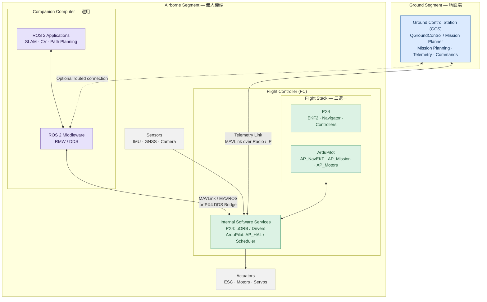

## 前言
因為一些原因開始接觸無人機資安，想說來記錄過程中的摸索並提供一些入門的起點。
(持續更新中，之後或許會盤出一點大的skills repo到github)

## 無人機架構盤點
目前的理解來看，無人機可以拆成
1. flight stack : 負責位置、控制、導航，大致簡稱飛控
2. middleware : 通訊連接硬體跟外部系統
3. Hardware/OS : 幾乎沒有包OS，在MCU上面跑

常見的 Flight Stack 幾乎都是 PX4和 Ardupilot 架構
下面用PX4為範例，middleware就是 mavlink

跟一般的 IoT 不太一樣，~~不是那種會飛的超級router而已~~
是以飛控為中心，用協議串聯不同的週邊設備

還會再搭配地面站跟伴飛電腦等等

## Awesome Related Sources

### 靶機相關

- **[Damn-Vulnerable-Drone](https://github.com/nicholasaleks/Damn-Vulnerable-Drone)**
	- 模擬 ArduPilot + MAVLink 架構與漏洞，可作本地靶機練習
	- 神之靶機
	- 本 vault 對應筆記：[[DVD_compare]] · [[DVD writeup]]
- **[Awesome-Drone-Hacking](https://github.com/nicholasaleks/Awesome-Drone-Hacking)**
	- 無人機駭客資源大全 (awesome-list)，本 SOP 攻擊面分類即依此架構拆解
	- 延伸筆記：[[DVD writeup]]

### 攻擊框架與工具集

- **[DroneSploit](https://github.com/dronesploit/dronesploit)**
	- 類似 Metasploit 的無人機專用攻擊框架
- **[Drone Hacking Tool](https://github.com/HKSSY/Drone-Hacking-Tool)**
	- GUI 工具，整合 USB WiFi 轉接卡 + HackRF One 進行無人機攻擊
	- 教學：[CSDN 文章](https://blog.csdn.net/gitblog_01194/article/details/154785891)

### 無人機韌體安全測試方法論

- **[OWASP FSTM (Firmware Security Testing Methodology)](https://github.com/scriptingxss/owasp-fstm)**
	- OWASP 韌體安全測試方法論，涵蓋取得、分析、模擬、動態測試全流程
	- 對應本 vault SOP：[[03_firmware]]
- **[OWASP ISTG (IoT Security Testing Guide)](https://github.com/OWASP/owasp-istg.git)**
	- OWASP 物聯網安全測試指南，含兩大部分：
		- **ISTG-PHY**：實體介面測試
		- 內部介面測試：UART / JTAG / SWD
- **[OWASP IoT Security Verification Standard (ISVS)](https://github.com/OWASP/IoT-Security-Verification-Standard-ISVS)**
	- OWASP IoT 安全驗證標準
- **[Drone Security Cheat Sheet](https://cheatsheetseries.owasp.org/cheatsheets/Drone_Security_Cheat_Sheet.html#4-physical-security)**
	- OWASP Cheat Sheet 系列，無人機安全速查表

### IoT / RF 通用安全資源

- **[awesome-connected-things-sec](https://github.com/V33RU/awesome-connected-things-sec)**
	- IoT 安全研究與漏洞利用技巧總匯，涵蓋 IoT、嵌入式、工控、車用系統
	- 偏基礎但全面
- **[RFSec-ToolKit](https://github.com/cn0xroot/RFSec-ToolKit)**
	- RF 通訊協定駭客工具集合，涵蓋 SDR、2G GSM、3G、4G LTE、5G 等協定分析工具與教學

### 無人機漏洞資料庫

- **[RVD (Robot Vulnerability Database)](https://github.com/aliasrobotics/RVD)**
	- 機器人/傳感器相關漏洞的歸檔資料庫，使用 RVSS (Robot Vulnerability Scoring System) 評分
	- 可用於比對無人機/機器人類 CVE 查核
- **[Infected Drones](https://github.com/nicholasaleks/infected-drones)**
    - DVD 靶機作者自己挖的洞集合
    - 有很多新的攻擊面，不定期會出現在他的 conf talk 上面
###  開源韌體與飛控生態

- **[awesome-open-source-drone-firmware](https://github.com/brandonhimpfen/awesome-open-source-drone-firmware)**
	- 開源無人機韌體、飛控軟體與相關工具清單彙整（ArduPilot/PX4 等主要開源韌體）
- **[AirData Firmware Wiki](https://app.airdata.com/wiki/Firmware/)**
	- 各廠牌無人機韌體版本與更新資訊 wiki
- **https://github.com/janesmae/awesome-drones**
	- 針對無人機的模擬、學習教材、飛控韌體、開發工具、模擬器、硬體和開源專案集中

